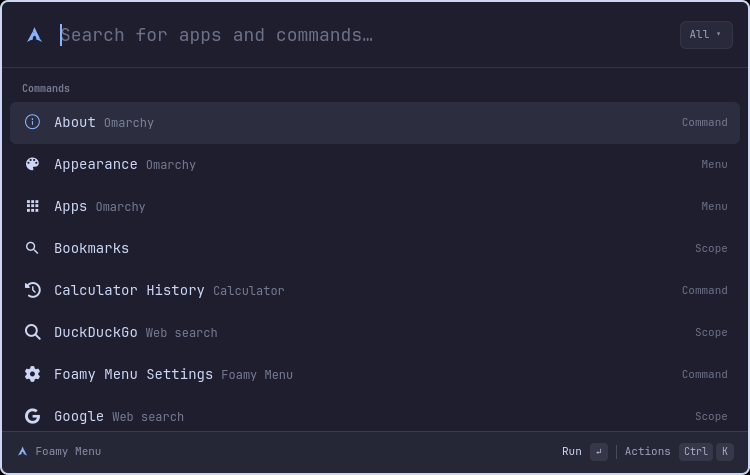

# Foamy Menu

An Omacast-based launcher for Omarchy with Foamy's configurable Arch icon.
Search apps and Omarchy actions, use aliases and favorites, open the action
panel, and calculate directly in the launcher. Scopes such as the built-in SSH
scope turn a keyword into a tag in the search field and list their own items.
Search ranking learns from use. The launcher follows the current Omarchy theme
and language (English and Norwegian).



The implementation is adopted from [Omacast](https://github.com/typecraft-dev/oma-cast),
snapshot `98bd0bb1cd1adf787afc704ff31f951d3c938708` (2026-11-02).
It lives in this repository and does not require the Omacast plugin.
Upstream MIT attribution is retained in [LICENSE-OMACAST](LICENSE-OMACAST).
The bundled flea-search helper retains its license and provenance in `search/`.

## Install and use

Requires Omarchy 4.5 with Quickshell and the stock menu components.
Search uses the bundled helper (`bin/x86_64/` and `bin/aarch64/foamy-menu-search`,
static binaries, no Rust needed). It starts with the first search and keeps
running; it receives the app and command list once, then one query per
keystroke, and skips fields that cannot match before scoring them. On other
CPUs, or when the helper exits or takes over a second to answer, the menu
uses its built-in matcher for the rest of the shell session. The same binary
lists the SSH scope's hosts (`foamy-menu-search ssh-hosts`) and the Games
scope's Steam games (`foamy-menu-search steam-games`), one short run each time
the scope loads; on a CPU without it, those scopes say the helper isn't
available.

```sh
omarchy plugin add https://github.com/foamrider/foamy-menu.git --enable
omarchy restart shell
```

The Arch bar button and the normal Super+Space menu shortcut open the launcher.
Right-clicking the bar button opens the default terminal.

- Enter opens the selected result (an app whose window is open is focused
  instead); Shift+Enter opens a new application window.
- Ctrl+K opens actions; Ctrl+Shift+F toggles a favorite; Ctrl+, opens the settings.
- Arrow keys navigate; Esc goes back or closes; Shift+Esc returns to root.
- The search field edits at its cursor: ← → move it (in grids they move
  between cells, in the settings they change values), Ctrl+← → jump a word,
  Home/End go to either end, Ctrl+B/F (or Ctrl+H/L with vim motions) move one
  character, and clicking the text places it. Backspace/Delete remove a
  character, with Ctrl a word; Ctrl+U clears up to the cursor. Typing and
  pasting insert at the cursor.
- **Apps** opens an icon grid of every application inside the launcher, A–Z,
  with the search field on top. Typing narrows and ranks the grid; arrow keys
  move in two dimensions; Esc clears the search, then goes back.
- **Games** (shown when Steam is installed) opens a grid of your installed
  Steam games' cover art, like Apps; Enter plays. `steam` + Tab too. Turn on
  **Steam games in search** to find games by name next to your apps.
- Type `ssh` and press Tab to search your SSH hosts; Enter connects.
  `g rust async` + Tab searches Google (`ddg` for DuckDuckGo). See
  [Scopes](#scopes) for adding your own.
- Type `2 + 3 * 4`, `20% of 50`, `5 ft to cm`, or `10 usd to eur` to calculate.
  The answer shows large on the right with the expression above it, written as
  Omarchy's language writes numbers and dates (`2 469 135,782`, `mandag 9.
  november 2026`). Enter copies it as shown; Ctrl+Shift+C copies the plain form
  (`2469135.782`); Ctrl+Enter pastes. Calculator History lists saved results.
- Typing follows the language too: with a decimal comma, `2,5 * 2` and
  `2 469 135,782 / 2` work and `;` separates function arguments
  (`max(1; 2)`). Norwegian words work alongside English: `5 fot til cm`,
  `20 % av 50`, `3 dager fra nå`, `tid i tokyo`, `12,50 kr til usd`.
- Dates: `om 3 dager` / `in 3 days`, `3 dager siden`, `i dag + 2 uker`,
  `neste fredag`, `i morgen`, `24. des`, `dager til jul` (Christmas Eve),
  `uker til 17. mai`, `dager siden nyttår`, `dec 24 - today`. Months can be
  short (`des`, `okt`, `dec.`), and with a day-first language `24.12` and
  `24.12.2026` are dates. A date written without a year counts to its next
  occurrence with `til`/`until` and from its last one with `siden`/`since`.
  A bare weekday, month or holiday stays a search; add a day, `neste` or
  `+ 0 dager` to get a date.
- Aliases, disabled commands, search history, unit/date/time-zone conversions,
  compact mode and zoom are inherited from Omacast.

These are the implemented upstream features. Raycast extensions, a settings
window, snippets and a dedicated clipboard history view are not implemented.

## Settings

Open **Foamy Menu Settings** with **Ctrl+,** or by searching "settings":

- Enter flips a switch or picks the next choice; ← and → step choices and
  numbers.
- Enter on a number or text (width, icon, font) edits it in the search field;
  Enter saves, Esc cancels. Empty means the default.
- Typing filters the list. Ctrl+K offers **Reset to Default** and **Copy
  Setting Command** (the `omarchy bar set` line, for your dotfiles).
- Sections: **Window**, **Search** (typo tolerance, SSH hosts, Steam games
  in search, **Open Scopes Folder**), **Web Search** (save web searches, web
  search suggestions, **Clear Saved Web Searches**), **Calculator** and
  **Bar Button**.

Settings are the `foamy.menu` entry in `~/.config/omarchy/shell.json`, as for
every Omarchy shell plugin: `manifest.json` declares them
(`barWidget.defaults` and `barWidget.schema`). The settings view writes there
through the shell (`updateEntryInline`, or `omarchy bar set` when the shell
does not allow it); you can also use `omarchy bar set` (`--json` for
`true`/`false` and numbers) or edit the file. Changes apply without a
restart. A missing or invalid value uses the default. `logLevel` is only in
`shell.json`.

```sh
omarchy bar set foamy.menu webSearchHistory true --json
omarchy bar set foamy.menu windowMode compact
omarchy bar get foamy.menu webSearchHistory
```

| Key | Default | Values | Meaning |
|---|---|---|---|
| `width` | `360` | 0–4096 | Minimum menu width (0 = default) |
| `icon` | Arch logo (`󰣇`) | string | Bar icon |
| `iconFont` | `""` | string | Icon font (empty = bar font) |
| `windowMode` | `"expanded"` | `expanded` / `compact` | Window: expanded, or compact (only the search field until you type) |
| `escapeKeyBehavior` | `"pop-back-or-close"` | `pop-back-or-close` / `close-and-pop-to-root` | Esc: go back one level, or close and start over |
| `popToRootTimeout` | `90` | 0–3600 | Seconds a closed launcher keeps its place (0 = always start over) |
| `navigationBindings` | `"emacs"` | `emacs` / `vim-motions` | Move keys besides the arrows: Ctrl+N/P (emacs) or Ctrl+J/K (vim-motions) |
| `rootSearchSensitivity` | `"medium"` | `low` / `medium` / `high` | How loosely search matches typos |
| `keepVisibleOnFocusLoss` | `false` | boolean | Stay open when clicking outside |
| `sshScope` | `true` | boolean | SSH scope (ssh + Tab) |
| `steamGames` | `false` | boolean | Find installed Steam games in the root search, as apps are (the Games grid shows whenever Steam is installed) |
| `webSearchHistory` | `false` | boolean | Save web searches and list them as Recent Searches |
| `webSearchSuggestions` | `false` | boolean | Show the search engine's suggestions while typing a web search (sends what you type to the engine) |
| `currencyRates` | `true` | boolean | Download exchange rates for currency conversion |
| `clockFormat` | `"auto"` | `auto` / `12h` / `24h` | Clock in time calculations (auto follows the system) |
| `remToPxRate` | `16` | 1–1000 | Pixels per rem in unit conversions |
| `workHoursPerDay` | `8` | 1–24 | Hours in a work day in time conversions |
| `logLevel` | `"info"` | `trace` / `debug` / `info` / `warning` / `error` / `fatal` | Log level |

`icon` and `iconFont` style the bar button and the launcher header (an empty
font uses Omarchy's). `width` is a minimum: the launcher keeps its 750-unit
layout and stays inside the screen; stock menus keep their own width rules.
Zoom (Ctrl +/−), favorites, aliases, ranking and history are not settings:
they are kept in `~/.local/share/foamy-menu/db/`.

## Scopes

A scope is a keyword that becomes a tag in the search field, and swaps the
list for the scope's own items. Enter one in either of two ways:

- Type its keyword and press **Tab**: `ssh` + Tab. Text after the keyword
  carries in as the scope's search, so `ssh prod` + Tab opens SSH searching
  for "prod".
- Select the scope's row in the root search (it ranks, and takes favorites
  and aliases, like any command) and press **Tab** or **Enter**.

Backspace on an empty search, Esc or a click on the tag leaves the scope.
Items are searched only inside their scope, not in the root search, unless
the scope sets `rootSearch` (Games does when `steamGames` is on). Recently
used items come first; the rest follow in the source's order.

### SSH (built in)

Lists every concrete `Host` in `~/.ssh/config` and the files it `Include`s
(patterns such as `*.internal` are skipped), with `user@hostname:port` from
the host's own blocks, read the way ssh reads them: keywords in any case,
`Key value` or `Key=value`, quotes and `#` comments; the first value of each
setting wins; `Include` is read where it stands (globs, relative paths under
`~/.ssh`, `~/`), each file once, so cycles are harmless. `Match` blocks and
pattern blocks such as `Host *` are not applied. Files are read with bounds
(1 MiB each, 256 files, Include depth 16) and only when they resolve to a
regular file; `FOAMY_SSH_CONFIG` names another config (for tests). Enter opens
the default terminal through `omarchy-launch-tui --app-id=TUI.tile` and runs
`ssh <host>`; if ssh fails, the window stays open until a key is pressed.
Ctrl+K offers **Copy SSH Command**, **Copy Host Name** and **Open in Files
(SFTP)**. Host names must be plain ssh destinations (letters, digits and
`_.:@%+-`, not starting with `-`). Turn the scope off with
`omarchy bar set foamy.menu sshScope false --json`.

### Games (Steam, built in)

When Steam is installed with at least one game, **Games** (subtitle Steam)
sits in the root search like **Apps**, and opens your installed games as a
grid of their cover art the same way, A–Z, with no scope tag in the search
field; typing narrows and ranks it, Esc or Backspace goes back. `steam` + Tab
opens it too. Without Steam (or without installed games) there is no Games
row and no `steam` keyword. A game without a cover shows its icon on a tile,
or Steam's icon.

Enter plays the game (`uwsm-app -- xdg-open steam://rungameid/<appid>`, so
Steam starts if it is not running, and the Flatpak works too). Ctrl+K offers
**Show in Library**, **Open Store Page** and **Copy App ID**.

**Steam games in search** (`steamGames`, off by default) also lists the games
in the root search, as apps are: typing a name shows the game (subtitle
Steam, type Game, its own icon) among the results, ranked like an application
and kept under the Applications filter, and Enter plays it:

```sh
omarchy bar set foamy.menu steamGames true --json
```

Everything is read locally, with nothing downloaded, by the bundled helper
(`foamy-menu-search steam-games`, Rust like the rest of the helper; one short
run, about 10 ms, when the launcher starts and each time it opens, so a newly
installed game shows up). It finds Steam in `~/.steam/steam`,
`~/.local/share/Steam` or the Flatpak's folder, reads every library in
`steamapps/libraryfolders.vdf` and its `appmanifest_*.acf` files, and takes
from `appcache/appinfo.vdf` what each app is (tools such as Proton and the
Steam Linux Runtime are left out) and its high-resolution icon
(`steam/games/<hash>.ico`). Covers come from Steam's own cache,
`appcache/librarycache/<appid>/`, so a game shows its cover once Steam has
shown it. Only installed games are listed. `FOAMY_STEAM_ROOT` names another
Steam folder (for tests).

### Web search (built in)

**Google** (`g`) and **DuckDuckGo** (`ddg`) are query scopes: they have no
list, the typed text is the item. `g rust async` + Tab, or `g` + Tab and then
typing, shows **Search Google for “rust async”**; Enter opens it in the
browser (`omarchy-launch-browser`). Enter with nothing typed opens the
engine's home page. Ctrl+K offers **Copy Search URL**.

Any text typed in the root search also ends with **Use “…” with…** rows, one
per query scope: Enter searches right away, Tab enters the scope with the
text.

Two extras fill the list. Both are **off** until you turn them on, for every
built-in engine at once:

```sh
omarchy bar set foamy.menu webSearchHistory true --json
omarchy bar set foamy.menu webSearchSuggestions true --json
```

- `webSearchHistory`: your searches in that engine are saved and listed under
  **Recent Searches**, ranked by use and narrowed by what you type. They stay
  in Foamy's own data (`~/.local/share/foamy-menu/db/frecency.json`), at most
  100 per scope. Ctrl+D deletes one; Ctrl+Shift+D clears the scope's history.
  With history off nothing is saved.
- `webSearchSuggestions`: the engine's autocomplete is listed under **Suggestions** as you
  type. This sends what you type to the engine (after a short pause, one
  request at a time); nothing is sent while it is off.

A scope file can set one engine differently, e.g. `{"id": "google",
"suggest": false}` in `~/.config/foamy-menu/scopes/google.json`.

### Your own scopes

Each scope is one JSON file in `~/.config/foamy-menu/scopes/` (created at
startup, owner-only). Files are watched: saving one applies it without a
restart. Scope files hold definitions; switching the built-ins on and off
is a [setting](#settings). A file whose `id` matches a built-in overrides only
the fields it sets, so this keeps the SSH scope but changes its keyword and
terminal:

```json
{"id": "ssh", "keyword": "s", "open": ["ghostty", "-e", "ssh", "{value}"]}
```

A new scope, for example tmux sessions in `~/.config/foamy-menu/scopes/tmux.json`:

```json
{
  "title": "Tmux",
  "subtitle": "Attach to a running session",
  "keyword": "tm",
  "itemsTitle": "Sessions",
  "placeholder": "Search sessions…",
  "source": {"type": "command", "command": ["tmux", "list-sessions", "-F", "#S"]},
  "open": ["omarchy-launch-tui", "tmux", "attach", "-t", "{value}"],
  "openTitle": "Attach",
  "actions": [{"title": "Copy Attach Command", "copy": "tmux attach -t {value}"}]
}
```

or a fixed list of bookmarks:

```json
{
  "id": "bookmarks", "title": "Bookmarks", "keyword": "bm",
  "source": {"type": "list", "items": [
    {"title": "Omarchy", "value": "https://omarchy.org"},
    "https://github.com"
  ]},
  "open": ["omarchy-launch-browser", "{value}"]
}
```

| Field | Default | Meaning |
|---|---|---|
| `id` | file name | Lowercase letters, digits and `-`; matches a built-in to override it |
| `enabled` | `true` | `false` hides the scope |
| `title` | required | The scope's name: its row, tag and footer |
| `subtitle` | `""` | Shown beside the row in the root search |
| `keyword` | `id` | Typed before Tab; no spaces; unique among enabled scopes |
| `icon` / `iconName` | search glyph | A font glyph, or a freedesktop icon name |
| `itemsTitle` | `"Items"` | Heading over the items when recent ones are shown first |
| `placeholder` | `"Search <title>…"` | The search field's hint inside the scope |
| `emptyText` | `"Nothing here yet"` | Shown when the source has no items |
| `source` | required | `{"type": "command", "command": [argv], "timeout": ms}`, `{"type": "list", "items": [...]}` or `{"type": "query"}` |
| `open` | required | argv run on Enter |
| `openTitle` | `"Open"` (`"Search"` for query) | Enter's name in the footer and action panel |
| `home` | none | Query scopes: argv run on Enter with nothing typed |
| `history` | `false` | Query scopes: save searches, list them as Recent Searches |
| `suggest` | `false` | Query scopes: list the engine's suggestions while typing |
| `suggestUrl` | none | Required for `suggest`: an https URL with `{query}` that returns OpenSearch suggestions (`["q", ["one", "two"]]`) |
| `valuePattern` | none | Regular expression a value must match before it is used |
| `rootSearch` | `false` | `true` lists the items in the root search while typing, ranked as applications (read at start and each time the launcher opens); not for query scopes |
| `requireItems` | `false` | `true` offers the scope (its row and keyword) only once its source lists something (Games: Steam installed with games); loads at start and each time the launcher opens |
| `itemLabel` | the title | The type shown beside each item ("Game") |
| `layout` | `"list"` | `list`, or a grid like Apps: `icons` (each item's icon) or `covers` (portrait cover art); not for query scopes. A grid scope opens like Apps: its row reads "Menu", and the search field shows no tag |
| `actions` | `[]` | Ctrl+K extras: `{"title", "copy": "text"}` or `{"title", "open": [argv]}` |

A command source prints one item per line,
`title<TAB>value<TAB>subtitle<TAB>icon<TAB>cover` (value defaults to the
title; the rest may be left out). `icon` is an absolute image path or an icon
name, `cover` an absolute image path; a grid layout shows them, and a list
shows the icon in place of the scope's. A `list` source's items take `icon`
and `cover` too. It runs when the scope is entered, with a
10-second default timeout (`timeout` 100–60000 ms): at the deadline the
command's process group (the command and what it started) gets SIGTERM, and
SIGKILL a second later. The previous list stays on screen while it
refreshes, and a failed run keeps it. At most 5000 items; the launcher reads
at most 8 MiB of a command's output (a fixed `bash` wrapper pipes it through
`head -c`), so a command that prints more is stopped there by SIGPIPE, and
the whole lines before the cut are its list.

A query scope is one more search engine, for example the Arch Wiki:

```json
{
  "id": "archwiki", "title": "Arch Wiki", "keyword": "aw",
  "source": {"type": "query"},
  "open": ["omarchy-launch-browser", "https://wiki.archlinux.org/index.php?search={query}"],
  "home": ["omarchy-launch-browser", "https://wiki.archlinux.org"]
}
```

Commands are argv arrays, and their arguments never become shell code: an
`open` command runs directly, and a `source` command runs as the arguments of
the fixed output-capping `bash` wrapper above. `{value}` (the
item's value, or a query scope's typed text), `{query}` (the same,
URL-encoded) and `{plugin}` (this plugin's directory) are replaced inside
single arguments, so a value with spaces or `;` stays one argument; `{value}`
cannot be the program itself. Use `valuePattern` when a program would read a
value starting with `-` as an option. A scope runs with your permissions, like
a desktop entry: only add commands you trust. Invalid files are skipped and
logged (`journalctl --user -t omarchy-shell | grep scopes`).

## Language

The launcher follows **Omarchy → Setup → Language** on Omarchy 4.5, without a
restart. English and Norwegian are included; other languages fall back to
English. Omarchy's own menu items use Omarchy's catalogs
(`default/i18n/<code>/menu.json`), so they match the stock menu, and the
English names stay searchable ("apps" still finds "Apper"). The calculator
reads and writes numbers and dates as the language does, names time units in
it, and understands Norwegian words as well as English; symbols (cm, kg, USD)
and the plain copy stay as they are.

Catalogs are `i18n/<code>.json`, keyed by the English text. Another language
is one file next to `no.json`; `tests/i18n.test.js` checks that every key has
an entry with the same `%1` holes. Strings go through foamy-kit's
`FoamyI18n` (`kit/`, synced from foamy-kit; do not edit it here).

## Menu routes

Foamy still owns the `omarchy.menu` replacement route. Root opens the new
launcher; named routes, input dialogs and selection dialogs use the installed
stock menu. **Stock Omarchy Menu** opens the original root menu. User menu
entries remain in `~/.config/omarchy/extensions/omarchy-menu.jsonc`.

The stock adapter uses private Omarchy menu internals for the window/card and
application library. The runtime tests check these against the installed host.
Menu entries' `when`, `checked` and `disabled` conditions run as one batch
that the stock menu's `MenuModel.js` builds; if that file is missing or
fails, Foamy builds an equivalent batch itself, so the conditions keep
working.

## Side-by-side Omacast

The original `typecraft.omacast` can be enabled alongside `foamy.menu`.
Use Omacast's Alt+Space binding for comparison. Foamy uses IPC/global shortcut
name `foamy-menu`, layer namespace `foamy-menu`, and separate XDG directories:

- Settings: the `foamy.menu` entry in `~/.config/omarchy/shell.json`
- Scopes: `~/.config/foamy-menu/scopes/*.json`
- Favorites, ranking, saved web searches (when on) and calculator history: `~/.local/share/foamy-menu/db/`
- Cache: `~/.cache/foamy-menu/`
- Logs: the journal (`journalctl --user -t omarchy-shell | grep foamy-menu`)

Foamy does not migrate, read or change Omacast's data. Both launchers use the
same installed application library and Omarchy actions.

Currency conversion downloads ECB rates from `api.frankfurter.dev` when the
cached rates are over 12 hours old (30-minute retry after failure).
`omarchy bar set foamy.menu currencyRates false --json` turns this off. Other calculations
work offline. History stays local, with owner-only directories and files.
Rates and web-search suggestions are fetched with `curl` over HTTPS, at most
256 KiB per reply (15 s for rates, 3 s for suggestions); a larger, slower or
failed reply is dropped. The URL goes to curl on stdin, never on its command line.

## CLI and development

```sh
bin/foamy-menu show               # also: toggle, hide, ping, isOpen, run <id> (omarchy-shell foamy-menu …)
bin/foamy-menu call calculator.calculate '{"query":"2+2"}'
omarchy bar set foamy.menu windowMode compact
bin/build-search                  # rebuild the bundled helper (developers; see below)
./test.sh                          # every test (tests/suite.sh); --fast skips the runtimes
python3 -I tests/launcher.py --shots /tmp/foamy-menu-shots
tests/validate.sh                  # linters, formatters, kit and helper checks, then the tests
```

`tests/validate.sh` is foamy-kit's validation command (`mise install` first
for the pinned tools; `--ci` is what GitHub's runner can do). It runs
`omarchy plugin validate .` among its checks.

The search helper is committed for x86_64 and aarch64 and falls back to the
built-in matcher when it is missing for the CPU or fails. After changing
`search/`, rebuild it with `bin/build-search` (also `foamy-menu build-search`):
it runs the plugin's own `kit/native/build-native.sh`,
which builds static musl binaries for both arches reproducibly with the pinned
toolchain (`rust-toolchain.toml`, rustup with the musl targets), installs
`bin/<arch>/foamy-menu-search` and updates `search/native.pin`. Cargo output goes
to `~/.cache/foamy-native/foamy-menu`, never into the plugin folder, which the
shell watches. `bin/build-search --test` runs rustfmt, clippy and the cargo tests;
`--verify` rebuilds from scratch and compares bytes. Commit the binaries and the
pin with the source. The helper tests (`cargo test --test protocol` in `search/`,
`node --test tests/*.test.js`) run against another build when `FOAMY_HELPER` holds
a JSON argv prefix with an absolute path, e.g.
`FOAMY_HELPER="[\"$PWD/bin/aarch64/foamy-menu-search\"]"` (qemu-user binfmt).
`tests/ssh-hosts.test.js` runs `foamy-menu-search ssh-hosts` next to the retired
Bash lister (`tests/fixtures/foamy-ssh-hosts.sh`, a test fixture only) over
fixture homes and requires the same bytes, or the documented ssh-correct
difference where the script misread `ssh_config`. `tests/fetch.test.js` runs
the bounded curl fetch (`core/Fetch.js`) against a local HTTPS server with a
throwaway `openssl` certificate: normal, oversized, endless and stalled replies.

No Node runtime is needed by the plugin; Node is used only for tests. Core logic
lives in `core/`, I/O in `services/`, and the launcher UI in `ui/`. `Menu.qml` routes between `Launcher.qml` and
`StockMenu.qml`; `BarWidget.qml` retains Foamy's bar styling. Scopes are
`core/Scopes.js` (definitions, merging, parsing) and `services/ScopeSource.qml`
(files and commands); the SSH scope lists hosts with
`foamy-menu-search ssh-hosts` (`search/src/ssh_hosts.rs`) and connects with
`bin/foamy-ssh-connect`.

`tests/runtime.py` exercises the stock adapter. `tests/launcher.py` exercises
the new launcher, action panel, calculator, Apps grid, scopes (a fake
`~/.ssh/config` read by the bundled helper, a user scope file, Enter through a
stubbed `omarchy-launch-tui`), keyboard navigation, theme/width layouts,
route handoffs, and the rates and suggestion fetches against a local HTTPS
server in an isolated offscreen shell with stub commands. It runs the
dark layout in English and the light layout in Norwegian. `preview.png` is
`root.png` from the English dark run of
`python3 -I tests/launcher.py --shots DIR`. `tests/app-focuser.py` runs the
app focuser against a fake `hyprctl`: quick repeated opens each focus the
open window.
The tests use the foamy-kit harness (`FOAMY_KIT`, default `~/GitHub/Personal/foamy-kit`).
They run on Omarchy 4.5: `FOAMY_HOST_45` (a shell directory), else
`$OMARCHY_TEST_ROOT/shell`, else the installed `/usr/share/omarchy/shell`.

After source edits, restart the shell to clear Quickshell's QML cache.
No upstream installation or migration scripts are included in Foamy's CLI.

## Verifying the helper binaries

`bin/x86_64/foamy-menu-search` and `bin/aarch64/foamy-menu-search` are compiled from the Rust source in this repository: `search/`, the
shared crate in `kit/rust/`, the dependencies locked in `Cargo.lock` and the
toolchain pinned in `rust-toolchain.toml`, with the build tool in
`kit/native/`. The build is reproducible. `search/native.pin` records the
toolchain, a hash of every build input (`source`) and the SHA-256 of each
binary.

**CI.** The [Verify native helpers](https://github.com/foamrider/foamy-menu/actions/workflows/verify-native.yml)
workflow rebuilds both binaries on a GitHub-hosted runner for every push,
compares them byte for byte with `bin/`, and attests the rebuilt files. To
check the committed files against that attestation (GitHub CLI):

```sh
gh attestation verify bin/x86_64/foamy-menu-search --repo foamrider/foamy-menu \
  --signer-workflow foamrider/foamy-menu/.github/workflows/verify-native.yml \
  --deny-self-hosted-runners
gh attestation verify bin/aarch64/foamy-menu-search --repo foamrider/foamy-menu \
  --signer-workflow foamrider/foamy-menu/.github/workflows/verify-native.yml \
  --deny-self-hosted-runners
```

Add `--source-digest <commit>` to require a particular commit.

**Yourself.** You need `rustup`, Python 3.11 or newer and `file`. From a
checkout of this repository at the commit you want to check:

```sh
rustup toolchain install "$(awk '$1 == "toolchain" { print $2 }' search/native.pin)" \
  --profile minimal --target x86_64-unknown-linux-musl,aarch64-unknown-linux-musl
kit/native/build-native.sh . --verify
```

It builds both binaries from scratch in `~/.cache/foamy-native/` (nothing is
written to the checkout), compares them byte for byte with `bin/`, checks
that the kit files are unmodified and that `native.pin` matches the source,
and ends with `verify OK (foamy-menu-search, <toolchain>, both arches reproducible)`.

### Building the helper yourself

To run binaries you built instead of the committed ones, build them in the
installed plugin with the same toolchain, then run `omarchy restart shell`:

```sh
cd ~/.config/omarchy/plugins/foamy.menu
kit/native/build-native.sh .
```

The build is reproducible, so `git status` shows no change when your
binaries match the release, and `omarchy plugin update` still applies.

## Remove

```sh
omarchy plugin remove foamy.menu
omarchy restart shell
```

Omarchy restores its stock menu. Foamy's history and settings are retained.
Removing Foamy does not remove the separate Omacast installation.

## License

[MIT](LICENSE), with [Omacast](LICENSE-OMACAST) and
[Omarchy](LICENSE-OMARCHY) MIT notices for adopted code.
